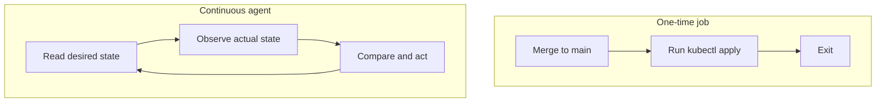

# One-Time Delivery Versus A Continuous Agent

A team keeps the manifests of the `starfleet` namespace in a Git repository. A delivery pipeline runs `kubectl apply` after every merge, and the cluster matches the repository at the end of every run. Two hours later, an administrator scales the `scout` Deployment by hand and nobody notices for a week. This part explains why the pipeline does not prevent that, what a continuous agent does differently, and how to tell the two designs apart.

Terms first. A **manifest** is a file that describes one Kubernetes object. The **desired state** is the set of manifests in the repository. The **actual state** is what the cluster holds right now. A **Deployment** is the Kubernetes object that keeps a set number of identical pods running. A **pod** is one running group of containers. A **GitOps agent** is a program that reads the desired state and works on the cluster to make the actual state match it.

## Two ways to apply a repository

A **one-time delivery job** runs when an event happens, for example a merge to the `main` branch. It checks out the repository, runs its commands, reports success or failure and exits. Between two runs, nothing watches the cluster. The job also holds no memory of what it applied, apart from its log.

A **continuous agent** does not end after one run. It repeats the same work: read the desired state, observe the actual state, compare, act if they differ, and start again. The work is the same as the job's work. What changes is that the agent returns to it without waiting for a person or a merge. In GitOps, this repeated return is what the word *continuous* means.



The diagram shows that the job has an end after one run and the agent has a return path to its first step.

## The same change in both designs

The playground for this module has a Git repository in `~/gitops-lab/play-010` and a cluster with the `scout` Deployment at two replicas. The latest commit in the repository sets `scout` to three replicas, but nobody has applied that commit yet. This is the state after a merge in which the pipeline did not run.

<!-- astrona:playground:renew -->

List the commits and the replica count that the latest commit declares:

```sh
cd ~/gitops-lab/play-010
git log --oneline
grep replicas apps/deployment-scout.yaml
```

The file says `replicas: 3`. Ask the cluster what it holds:

```sh
kubectl -n starfleet get deployment scout
```

The column `READY` shows two pods. `kubectl diff` compares the files with the live objects and prints every difference. It exits with status 0 when nothing differs and with status 1 when something differs, which is how a script can use it:

```sh
kubectl diff -R -f apps
echo "exit status: $?"
```

The output shows the `replicas` line changing from 2 to 3 and the exit status is 1. Now act on the difference. The command `kubectl apply -R -f apps` reads every file under `apps` and sends the objects to the API server:

```sh
kubectl apply -R -f apps
kubectl -n starfleet rollout status deployment/scout
```

That is one reconciliation pass done by hand. You were the agent for one cycle.

## What the job cannot do

Now simulate the manual change from the opening paragraph. Scale `scout` to one replica with a command that does not touch the repository:

```sh
kubectl -n starfleet scale deployment scout --replicas=1
kubectl diff -R -f apps
```

The diff shows that the cluster no longer matches the repository. The Kubernetes control plane accepts the change because the administrator is allowed to scale. No component in this setup compares the cluster with Git, so the difference stays. A pipeline that ran once at merge time has already finished and will not run again until the next merge.

A continuous agent closes this gap by running the same comparison on a schedule. On its next pass, it sees the replica count of one, reads three from the repository and applies the file. The cluster returns to three replicas without any person starting a job. This is the first of the two properties that make a system continuous in the GitOps sense: **the work repeats without a new trigger**.

## What an agent needs in order to repeat

Repeating is only useful if each pass is safe and has a source to read. Four conditions follow from that.

First, the agent needs **durable access to the desired state**. A merge event carries the commit with it. An agent that only knows what an event delivered once has nothing to read on its next pass. It must be able to fetch the repository, or a stored version of it, whenever it wants.

Second, each pass must be **safe to repeat**. Applying a manifest that the cluster already satisfies changes nothing. Kubernetes `apply` behaves this way because it sends the desired fields and the API server only changes what differs. A script that runs `kubectl create` fails on its second run, because the object exists, and a script that appends to a list would grow it on every pass.

Third, the agent needs **permission** to change what it manages. A loop that runs every minute but receives `Forbidden` from the API server repeats a failure and corrects nothing.

Fourth, the agent needs **a defined scope**. Two agents that write different values to the same field repeat their changes forever, each undoing the other. Continuous operation requires one clear owner for each managed field.

## Telling the designs apart

When an exam question or a real system description says "continuous", check these facts rather than the word:

- Does a component start work again without a human or a new merge?
- Where does that component read the desired state from on each pass?
- What does it do when the state already matches?
- What does it report when it cannot make progress?

A pipeline that runs `kubectl apply` on a schedule of its own is closer to continuous than one that runs only on merge, but it still may lack a comparison step and status reporting. A controller inside the cluster that watches a Git source and an applied object has all of them.

Continuous does not mean instant. The agent still needs time to fetch, compare and apply, and then the cluster needs time to start pods. You now know that a one-time job applies a revision once, that an agent returns to the same work, and that the return only helps when each pass is safe, authorized and has one owner.

## Common pitfalls

> [!WARNING]
> A green pipeline run shows that one apply succeeded at one moment. It does not show that the cluster still matches Git now. Do not call a pipeline continuous because it runs often: look for the repeated compare step and a durable source. Do not use `kubectl create` in a loop; use `apply`, which is safe to repeat.
