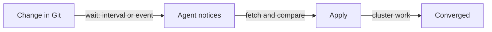

# Intervals, Events And Missed Events

A continuous agent returns to its work, but how often, and what starts the return? A team that sets the interval to ten minutes accepts that a manual change can last ten minutes. A team that relies only on a notification from the Git server accepts that one lost notification can leave the cluster outdated for as long as nothing else happens. This part explains the two ways an agent starts a pass, what each one costs, and why the second keeps the system correct when the first fails.

## Polling, events and the time they take

**Polling** means the agent starts a pass on a timer. The time between two starts is the **interval**. Polling needs nothing from the Git server except the ability to answer a read request, so it keeps working when other components are down.

An **event** is a message that something changed, for example a webhook. A **webhook** is an HTTP request that one system sends to another when something happens, such as the Git server telling the agent about a new commit. An event can start a pass at once instead of waiting for the next timer.

The delay between a change and the cluster matching it is the **convergence time**. It is the sum of several parts: the wait until the agent notices the change, the time to fetch the new revision, the time to compare and apply, and the time the cluster needs to finish the change. For a Deployment, the last part includes starting new pods and waiting until they are ready. With a polling interval of 60 seconds, the first part is between 0 and 60 seconds, 30 seconds on average. Events shorten that first part. They do not change the others.



The diagram shows that the interval only controls the first wait, while fetching, applying and the cluster's own work add to the total.

## What an interval costs

A short interval finds changes sooner but sends more requests. Each pass reads the Git source and the cluster API. With one agent and a few manifests, a pass every ten seconds is cheap. With hundreds of applications and many agents, the same setting multiplies the read load on the Git server and on the Kubernetes API server. A long interval costs little load and lets a drift last longer.

There is no value that is right for every system. Teams pick a value from three facts: how long a difference may last before it matters, how much load the Git server and the API server accept, and how long a pass takes. An interval shorter than the pass duration only makes passes overlap, so agents also avoid starting a pass while the previous one runs.

## Build the loop and see the interval

In the playground, `~/gitops-lab/play-010` holds the repository. Write the loop as a script. A shell variable `INTERVAL` sets the time between passes, and the variable `RECONCILE_ONCE` makes the script stop after one pass, which is useful for testing. Save this as `reconcile.sh` in the repository root:

```sh
#!/usr/bin/env bash
INTERVAL="${INTERVAL:-30}"
cd "$(dirname "$0")"

while true; do
  echo "$(date -u +%H:%M:%S) revision $(git rev-parse --short HEAD)"
  if ! kubectl diff -R -f apps > /dev/null; then
    kubectl apply -R -f apps
  fi
  if [ -n "${RECONCILE_ONCE:-}" ]; then
    exit 0
  fi
  sleep "$INTERVAL"
done
```

The script prints the Git revision it works on, compares with `kubectl diff`, applies only when the diff exits with a non-zero status and then waits. Make it executable and run one pass:

<!-- astrona:playground:renew -->

```sh
cd ~/gitops-lab/play-010
chmod +x reconcile.sh
RECONCILE_ONCE=1 ./reconcile.sh
```

If the playground still holds the revision that sets three replicas for `scout`, this pass applies it. Now run the loop with a short interval in the foreground and, in a second terminal, change the cluster by hand:

```sh
INTERVAL=10 ./reconcile.sh
```

```sh
kubectl -n starfleet scale deployment scout --replicas=1
kubectl -n starfleet get deployment scout --watch
```

Within about ten seconds the loop prints a new line, finds the difference and applies the file. The watch output shows the replica count return to the value in Git. The time you waited is the interval plus the apply. Stop the loop with Ctrl-C when you are done.

## Events and missed events

Polling alone has a weakness: every change waits for the next timer. Teams therefore add events. When the Git server sends a webhook on every push, the agent starts a pass immediately and the first wait drops to a few seconds.

An event is a **signal to look**, not a complete record of what happened. Networks lose requests, an agent that restarts misses what the Git server sent while it was down, and a Git server can send the same webhook twice. If the agent applied only what an event carried, a lost event would mean a lost change, and nothing would repair it.

A **missed event** is an event that never reached the agent or that the agent did not process. The way to recover is that the agent does not need the event to know what the desired state is. On its next timer, it reads the repository again and compares it with the cluster. The repository, not the event, is the source of truth. Events make the agent faster, and the timer makes it correct.

You can see this in the playground by making a change without any signal. Add a commit that changes the `probe` Deployment to two replicas, and do not apply it:

```sh
sed -i.bak 's/replicas: 1/replicas: 2/' apps/deployment-probe.yaml
rm apps/deployment-probe.yaml.bak
git add apps/deployment-probe.yaml
git commit -m "Scale probe to two replicas"
```

No webhook was sent to the loop. If the loop from the earlier step is still running, it applies the commit on its next pass anyway, because it reads the working directory each time. The delay is bounded by the interval.

## Repeating safely, and failing safely

A repeated pass can also fail. The Git server can be unreachable, the API server can refuse a request, or a manifest can be invalid. A good agent records the failure and tries again on the next pass. It does not stop, and it does not retry in a tight loop. A tight retry loop against a failing dependency adds load exactly when that dependency is struggling, so agents use a growing delay between retries after repeated failures.

Repetition is also safe only when the pass is idempotent, which means that running it again with the same input changes nothing. The script above uses `apply`, which sends the desired fields and lets the API server change only what differs. A pass that ran `kubectl create` would fail on its second run.

You now know that the interval sets how fast the agent notices, that events make it faster, and that the timer makes it recover from lost events. One question remains open: how does a person see that the agent is working? An agent needs to report the revision it evaluated and the result of its last pass.

## Common pitfalls

> [!WARNING]
> An event is not the state itself. Do not design an agent that applies only the content of a webhook; it cannot recover when one webhook is lost. Do not read "continuous" as "instant": the interval, the fetch and the cluster's own work all add delay. Do not set an interval shorter than one pass takes. Retry failures with a growing delay, not in a tight loop.
