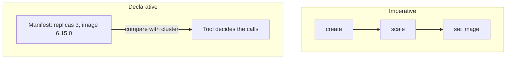

# Declarative Versus Imperative Descriptions

A team needs three replicas of the `scout` service. One engineer writes a shell script that runs `kubectl create deployment` and then `kubectl scale`. Another engineer writes a file that says "a Deployment named `scout` with three replicas of this image". Both produce the same result on an empty cluster. This part explains why GitOps requires the second form, and what goes wrong with the first when the script runs a second time or when the cluster is not empty.

Terms first. A **declarative description** states the result that must exist: which objects, with which fields and values. An **imperative procedure** lists the steps to perform, in order. The **desired state** is the result that a declarative description states. A **manifest** is a file that describes one Kubernetes object.

## The same goal in two forms

The imperative form is a list of commands. Each command assumes the state that the previous command left behind:

```sh
kubectl create deployment demo --image=ghcr.io/stefanprodan/podinfo:6.15.0 --replicas=2
kubectl scale deployment demo --replicas=3
```

The declarative form is a manifest. It does not say how to reach the state, only what the state is:

```yaml
apiVersion: apps/v1
kind: Deployment
metadata:
  name: demo
  namespace: starfleet
spec:
  replicas: 3
  selector:
    matchLabels:
      app: demo
  template:
    metadata:
      labels:
        app: demo
    spec:
      containers:
        - name: demo
          image: ghcr.io/stefanprodan/podinfo:6.15.0
```

The manifest has one fact for each field. There is no step that says "create" or "scale". Which API call is needed, and whether any call is needed at all, is decided by the tool that reads the manifest, by comparing it with what exists.



The diagram shows that the imperative form is a sequence that depends on the order of its steps, and the declarative form is one statement that a tool compares with the cluster.

## What happens when you run each form twice

The playground for this module has a cluster with the `starfleet` namespace and a Git repository in `~/gitops-lab/play-020`. Run the imperative commands twice and watch the second run.

<!-- astrona:playground:renew -->

```sh
kubectl -n starfleet create deployment demo --image=ghcr.io/stefanprodan/podinfo:6.15.0 --replicas=2
kubectl -n starfleet create deployment demo --image=ghcr.io/stefanprodan/podinfo:6.15.0 --replicas=2
```

The first command creates the Deployment. The second command fails with an error that says the object already exists (`AlreadyExists`). The commands describe an action, and the action cannot be done twice. A script that fails on its second run cannot be repeated by an agent.

Now do the same with a manifest. Save the YAML above as `deployment-demo.yaml`, and apply it twice:

```sh
kubectl apply -f deployment-demo.yaml
kubectl apply -f deployment-demo.yaml
```

The first run reports that the Deployment was configured, because the manifest has `replicas: 3` and the existing object has two. The second run reports that it is `unchanged`. The tool compared the manifest with the object, found no difference and sent no change. This property is **idempotence**: running the operation again with the same input leaves the same result.

## Idempotence is what repetition needs

A GitOps agent runs its pass again and again. Each pass must work whether the cluster is empty, partly correct or already correct. A declaration gives it that, because the question each pass answers is "what is different?", and not "what did I already do?". An imperative script has to know its own history. If a script created the Deployment last time, this time it must scale. If it did not, it must create. Writing that logic by hand is the work that a declaration removes.

## What a declaration hides, and what it does not

A declaration is independent of one implementation of how to reach the state. The manifest above works with `kubectl apply`, with an agent in the cluster and with a pipeline step. All three send the same object to the API server. The API server and the Deployment controller do the work. This is **implementation independence**: the description does not name the tool that applies it.

The independence has limits. A manifest is written for one API, so it names an `apiVersion` and a `kind`. It is also written for one kind of runtime, so a Deployment manifest means nothing to a system without Kubernetes. A declaration is independent of the tool that applies it, not of the platform that interprets it.

## Declarative does not mean "no steps happen"

Something still performs steps. The controller starts pods one after another and the scheduler chooses nodes. The difference is who owns the steps. In an imperative script, the author owns them and must handle every starting condition. In a declarative system, the controller owns them and handles the conditions. The author owns the statement of the result.

This also explains a common mistake. A file in Git that holds a list of commands, for example `scripts/deploy.sh`, is stored in Git, but it is not a declarative description. Putting a procedure in a repository gives it a history. It does not give it the properties above. The agent cannot compare a script with the cluster, so it can only run it again and hope.

## What you now know

A declaration states the result and leaves the sequence to the controller, which is why a manifest can be applied again without harm and a create command cannot. The next question is how complete a declaration must be for a different machine, or the same machine on another day, to produce the same result. A manifest that leaves out its namespace, its image tag or a dependency can mean different things in different places.

## Common pitfalls

> [!WARNING]
> Storing a script in Git does not make it declarative. Do not use `kubectl create` in an automated loop, because it fails on the second run. Do not assume that `apply` is magic: it compares the manifest with the live object, so fields that the manifest does not mention are left as they are.
