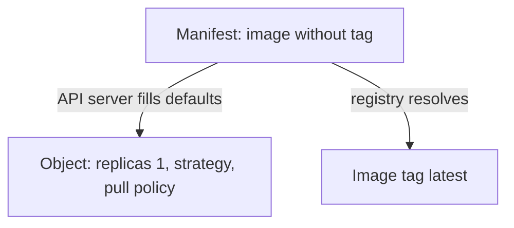

# Scope, References, Defaults And Dependencies

A manifest that works on one engineer's laptop can create objects in the wrong namespace on a production cluster, pull a different image a month later or fail because a ConfigMap that it uses was never committed. In each case the file was valid and the description was incomplete. This part lists the four things a declaration must state itself: its scope, its references, its defaults and its dependencies.

## Scope: where the object belongs

A **namespace** is a named group in a cluster that holds namespaced objects. A manifest that omits `metadata.namespace` does not say where the object belongs. `kubectl` fills in the namespace from the current context, which is a setting on the machine that runs the command. The same file then creates the object in `default` on one machine and in `starfleet` on another.

Declare the scope in the file. For a namespaced object, write `metadata.namespace`. The namespace itself is a cluster-scoped object, so it needs its own manifest before the objects that live in it. An agent has no kubeconfig context that a person selected, so it relies on what the file says.

## References: names that stay the same

Objects refer to other objects by a name or a label. A Service selects pods by label. A Deployment's `selector` must match its pod template labels. A pod refers to a ConfigMap by name. These references work only if the name is stable and the target is declared.

Image references are the most important example. The image `podinfo:6.15.0` names a tag, and a registry can change what a tag points to. A **digest** (`podinfo@sha256:...`) names the exact content and cannot change. A tag is a reference that people agree not to move, and a digest is a reference that cannot move. Choose by how much change you accept.

## Hidden defaults

A **default** is a value that a system fills in when the manifest leaves the field out. Defaults make manifests shorter, and they make the description incomplete, because the real value is decided somewhere else.

Take an image without a tag. The tag `latest` is used. The image then changes whenever someone pushes a new `latest`, although the manifest did not change. Defaults also come from the API server. The Deployment controller sets a rolling update strategy, and the API server sets `imagePullPolicy`, which depends on the tag.

You can see the values that the API server adds. In the playground, save this as `deployment-defaults.yaml`:

```yaml
apiVersion: apps/v1
kind: Deployment
metadata:
  name: defaults
  namespace: starfleet
spec:
  selector:
    matchLabels:
      app: defaults
  template:
    metadata:
      labels:
        app: defaults
    spec:
      containers:
        - name: defaults
          image: ghcr.io/stefanprodan/podinfo
```

<!-- astrona:playground:renew -->

Ask the API server to process it without saving it:

```sh
kubectl apply --dry-run=server -o yaml -f deployment-defaults.yaml
```

The printed object contains fields that the file never mentioned, for example `replicas: 1`, a `strategy` and an `imagePullPolicy`. The manifest also leaves out the image tag, so the image resolves to `latest`. Each of these is a decision that the file left to a default.



The diagram shows that the stored object holds more values than the file, and that the image meaning comes from the registry and not from the file.

## Dependencies the file does not carry

A **dependency** is something that an object needs in order to work. A Deployment can refer to a ConfigMap that holds its settings. If the ConfigMap is not declared next to the Deployment, the Deployment is valid and the pods do not start.

Save this as `deployment-missing-config.yaml`:

```yaml
apiVersion: apps/v1
kind: Deployment
metadata:
  name: needs-config
  namespace: starfleet
spec:
  selector:
    matchLabels:
      app: needs-config
  template:
    metadata:
      labels:
        app: needs-config
    spec:
      containers:
        - name: needs-config
          image: ghcr.io/stefanprodan/podinfo:6.15.0
          envFrom:
            - configMapRef:
                name: needs-config-settings
```

```sh
kubectl apply -f deployment-missing-config.yaml
kubectl -n starfleet get pods -l app=needs-config
```

The API server accepts the Deployment, because it checks the structure and not whether a ConfigMap exists. The pod status shows `CreateContainerConfigError`, which means the kubelet (the agent that starts containers on a node) could not build the container configuration. Describing the pod names the missing ConfigMap. The fix is to declare the ConfigMap in the same repository, so that the description contains everything that the object needs.

Some dependencies cannot be declared in the same place: a database that another team runs, a DNS record, a certificate issued by an outside system. A complete description at least states the name of what it needs, and does not hide the need inside a default or a manual step.

## What to check in a declaration

- Does every namespaced object name its namespace, and is the namespace declared?
- Are images referenced by a tag or digest that you accept, and not by a default?
- Does every object that is referred to exist in the repository, or is its absence recorded?
- Which values come from defaults, and do you accept them?

Together, the four answers tell whether two applications of the same file on two clusters mean the same thing. A declaration that passes them needs nothing from the place where it is applied except the platform. You now have the checks that make a description complete, and the next topic, the state that Git holds as a whole, builds on them.

## Common pitfalls

> [!WARNING]
> A valid manifest is not a complete description. The API server checks structure and not whether the namespace, the image tag or a referenced ConfigMap is what you intended. Do not leave the namespace to the current context, do not omit image tags, and do not assume that a Deployment that was accepted is running.
