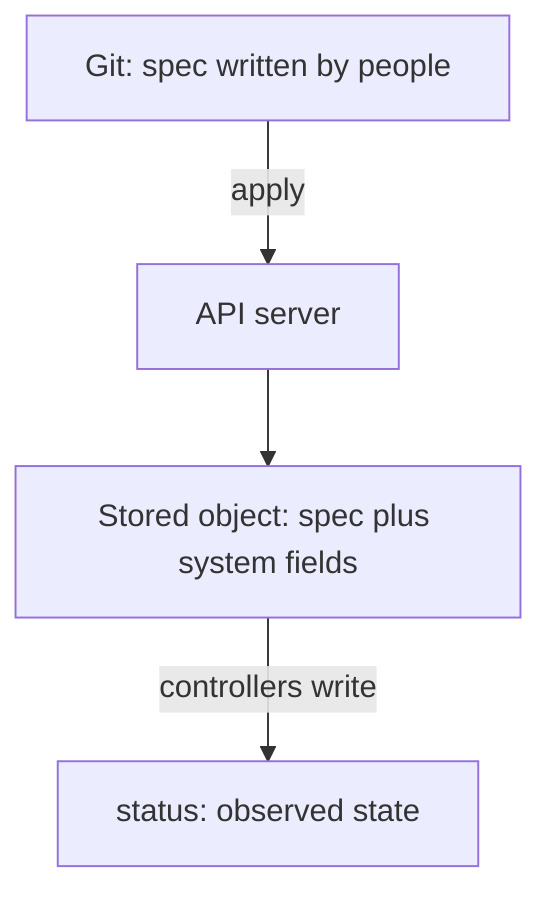

# What Belongs In The Desired State

A new engineer needs the `scout` Service in Git. The fast way is to ask the cluster for it and commit the answer. The file looks complete: it has every field. Applied to a different cluster, it is refused or it carries values that belong to the first cluster. This part explains why, and how to tell which fields belong in Git and which do not.

Terms first. The **desired state** is the set of objects and field values that people declare as correct. It is the input to the system. The **observed state**, also called the live state, is what the cluster reports now. A **state store** is the place that holds the desired state. In GitOps that place is a Git repository.

## One object holds both kinds of data

Every Kubernetes object has a `spec`, which is the part that someone declares, and many have a `status`, which is the part that the system fills in to report what it observed. An object also has `metadata`, which mixes fields that people set (name, namespace, labels) with fields that the system sets.

<!-- astrona:playground:renew -->

Ask the cluster for the `scout` Service as YAML:

```sh
kubectl -n starfleet get service scout -o yaml
```

The output has more fields than the manifest that was applied. The ones that the system added fall into groups:

- Identity assigned on creation: `metadata.uid` and `metadata.creationTimestamp`. They are unique to this object in this cluster.
- Version counters: `metadata.resourceVersion` and `metadata.generation`. They change each time the object changes, and they are used for conflict detection.
- Bookkeeping: `metadata.managedFields` records which tool set which field, and an annotation can hold the last applied configuration.
- Allocated values: for a Service, `spec.clusterIP` and `spec.clusterIPs` are addresses that the cluster picked from its own range.
- Observed results: everything under `status`.



The diagram shows that people write only the spec, and that the stored object also holds fields that the system adds afterward.

## Why generated fields do not belong in Git

Each group fails in its own way when it is stored as desired state.

`uid` and `creationTimestamp` describe one object in one cluster. On create, the API server assigns them, so a manifest that carries them either conflicts with the assigned value or states something that is false for the new cluster. A `uid` in a file means the file describes a specific object and not a kind of object.

`resourceVersion` is a counter used for optimistic concurrency. When an update carries a `resourceVersion`, the API server accepts it only if it equals the stored one. A committed value is old almost at once, so applying the file later produces a conflict error. Even when it is accepted, the file says something about the history of one object and not about the goal.

`clusterIP` is an address from the cluster's Service range. Another cluster has another range, and a fixed address can be taken or out of range. The address was a result, and the declaration is "a Service that is reachable inside the cluster".

`status` is a report. Writing it in Git means a person claims what the cluster observed. The controller overwrites it in the next pass, so the committed text becomes false.

## The test for a field

Ask who owns the field. If a person decides the value and would be able to defend it, it belongs in the desired state. If the system decides the value from other facts, it does not. The name, the namespace, the labels, the replicas, the image and the ports are decided by people. The uid, the version counters, the allocated address and the status are decided by the system.

A few fields sit in between. A value that a person may leave out and the system fills in, such as a default, can be stated or omitted. The earlier decision about hidden defaults applies: state the ones that matter to you. A value that a person could not choose, such as a uid, never belongs in the file.

## Clean an export

You can see the difference between a spec and an export with a dry run. Save this as `service-export.yaml`, a typical export with generated fields still in it:

```yaml
apiVersion: v1
kind: Service
metadata:
  creationTimestamp: "2026-01-10T09:00:00Z"
  name: scout
  namespace: starfleet
  resourceVersion: "48213"
  uid: 5b1f0c0e-1111-4222-8333-444455556666
spec:
  clusterIP: 10.96.14.20
  clusterIPs:
    - 10.96.14.20
  ports:
    - port: 9898
      targetPort: 9898
  selector:
    app: scout
  type: ClusterIP
status:
  loadBalancer: {}
```

Ask the API server to check it without saving anything:

```sh
kubectl apply --dry-run=server -f service-export.yaml
```

The server either rejects the file or reports a conflict, because the `resourceVersion` and the `uid` do not match the stored object, and the address is already allocated to the real Service. Remove the five generated entries (`creationTimestamp`, `resourceVersion`, `uid`, `clusterIP` with `clusterIPs`, and `status`), and the file becomes the same Service that the spec described. What remains is the name, the namespace, the ports, the selector and the type, which are the facts that people decided.

## A repeatable habit

When you take an object from a cluster into Git, treat the output as raw material. Keep the fields that people own and delete the rest. Prefer writing the manifest from the intent and comparing it with the cluster, which tests the intent. Exporting is for objects that already exist and whose intent you must recover.

You now can tell the part of an object that is a goal from the part that is a record. The next question is what the state store itself must guarantee, so that the goal can be trusted over time.

## Common pitfalls

> [!WARNING]
> Committing the output of `kubectl get -o yaml` stores the history of one object, not its goal. Remove `uid`, `resourceVersion`, `creationTimestamp`, `managedFields`, allocated addresses and the whole `status` block before the file goes into Git, and never commit a value that you did not choose.
