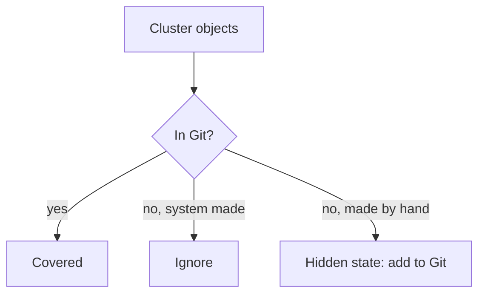

# Versioned, Immutable And Complete

The desired state is only useful if people can trust it. They need to know what it said last week, who changed it, that nobody rewrote the record afterward and that nothing the cluster runs is missing from it. This part explains the three properties of the state store that make that trust possible: versioned, immutable and complete.

## Versioned: every change is a recorded step

A state store is **versioned** when each change creates a new, named version and the earlier versions remain. Git does this with commits. A **commit** is a snapshot of the whole tree together with its author, its time and a message, and a pointer to its parent commit. The chain of parents is the history.

The history answers questions that a live cluster cannot. A cluster shows the state now. Git shows what the state was at any commit, which commit changed a field, and by whom. When something breaks, the first question is "what changed?", and a versioned store answers it with a diff between two commits.

## Immutable: a version cannot be altered

**Immutable** means that a version, once created, never changes. In Git, the identifier of a commit is a hash computed from its content and from the identifier of its parent. If the content changed, the hash would change, and the result would be a different commit. A commit with a given hash is therefore the same content every time anyone reads it.

This matters because the agent and the auditor refer to a state by that hash. If the content behind a hash could change, "the cluster runs commit abc123" would not mean anything fixed. A name that points to content that can move is not a fixed reference. A branch is such a name: it moves when someone adds a commit. A tag is meant to stay on one commit.

Immutability has limits that you should know. Git lets a person rewrite history, for example with a forced push that replaces a branch with different commits. The old commits are not changed, but the branch no longer points at them, and anyone who relied on the branch sees a different history. The store is immutable at the level of commits, and a protection rule on the server is what keeps branches from being rewritten.

## Complete: nothing runs that Git does not describe

A state store is **complete** when every object that the cluster should have is in it. An object that exists only in the cluster is a hidden part of the system. Nobody can review it, nobody can recover it after the cluster is lost, and the agent cannot tell whether it is intended.

You can compare the two sides. In the playground, list what runs in the namespace, and list what the repository would create. First the cluster side:

<!-- astrona:playground:renew -->

```sh
kubectl -n starfleet get deployments,services,configmaps -o name
```

Then the repository side, from the repository directory `~/gitops-lab/play-030`. The dry run reads the files and prints the objects they declare, without contacting the API server for any change:

```sh
cd ~/gitops-lab/play-030
kubectl apply --dry-run=client -R -f apps -o name
```

Compare the two lists. An object in the first list and not in the second exists in the cluster without a description. An object in the second and not in the first has not been applied. Some objects are created by the system, for example the ConfigMap `kube-root-ca.crt` that every namespace receives. They are not part of the desired state, because the cluster makes them by itself.



The diagram shows three outcomes for a cluster object, and only the object made by hand is a gap in the description.

## What about secrets

Some desired state is confidential, such as a password. A Secret object holds its values only base64 encoded, and encoding is not encryption. A plain Secret in Git exposes the value to everyone who can read the repository, and because history is immutable, deleting it later does not remove it from old commits. A complete description of a secret therefore stores either an encrypted form that only the cluster can decrypt, or a reference to a store that lives elsewhere. The object is described, and the value is protected.

## Reading the history with Git

The history is only useful if you can read it. Three commands cover most questions, and you can run them in the repository of the playground:

```sh
git log --format='%h %an %ad %s' --date=short
git show HEAD --stat
git diff HEAD~1 HEAD -- apps
```

The first command lists commits with a short hash, the author, the date and the message. The second shows what the latest commit changed, file by file. The third prints the exact lines that changed between two commits. A reviewer who reads the third output before a change is applied is doing the work that the versioned store exists for: the change is visible as text before it reaches the cluster.

The author and the message belong to the record. A message such as "fix" tells the next reader nothing, and a message that states the reason lets them judge the change without opening the diff. The author is recorded by name and email as the committer configured them, so it is a claim and not proof. When proof matters, commits can be signed with a key, and the server can refuse unsigned commits. That is a property of the platform that hosts the repository and not of Git alone.

## Pinning a version with a tag

A branch name moves each time a commit is added, so a statement such as "production runs main" changes meaning over time. A **tag** is a name that is created once and stays on the same commit. An **annotated tag** also stores a message and the identity of whoever created it. Naming a release with a tag gives people and tools a fixed name for a fixed state:

```sh
git tag -a release-1 -m "State approved for the outpost"
git rev-parse release-1
```

The second command prints the commit hash that the tag points to. If the tag is deleted and created again on another commit, the name moves, so the protection rules on the server should treat release tags as protected. The hash stays reliable in every case, which is why audits record hashes and not only names.

## What goes wrong when a property is missing

Suppose the store is versioned but not immutable. A person rewrites history to remove a bad commit, and the cluster agent already applied that commit. The agent now points at a commit that no branch contains, and the record of what ran is gone. Suppose the store is immutable but not complete. A person fixes an incident by editing a Deployment in the cluster, and the fix is never committed. The next reconciliation either reverts the fix or leaves a difference that nobody can explain from the history.

Suppose the store is complete and immutable but not versioned in practice, for example because every change is a squashed commit named "update". The facts are there, but the questions what changed, why and by whom cannot be answered. The three properties are needed together, and each one is checked by a different habit: reading diffs for versioned, protecting branches and tags for immutable, and comparing the repository with the cluster for complete.

## How the three properties support each other

Versioned gives the history. Immutable makes the history reliable. Complete makes the history the whole story and not a part. If one is missing the trust fails: a complete but mutable store can be edited after the fact, and an immutable store with gaps hides things in the cluster. The agent can only reconcile what the store describes, so a gap is also a part that nothing keeps correct.

## Common pitfalls

> [!WARNING]
> Treat a branch as a moving name and a commit hash as the fixed reference. Do not rewrite shared history, and do not commit plaintext secrets, because immutability keeps the value in old commits. Do not count system-made objects such as `kube-root-ca.crt` as gaps, and do not leave objects that people created by hand without a manifest.
