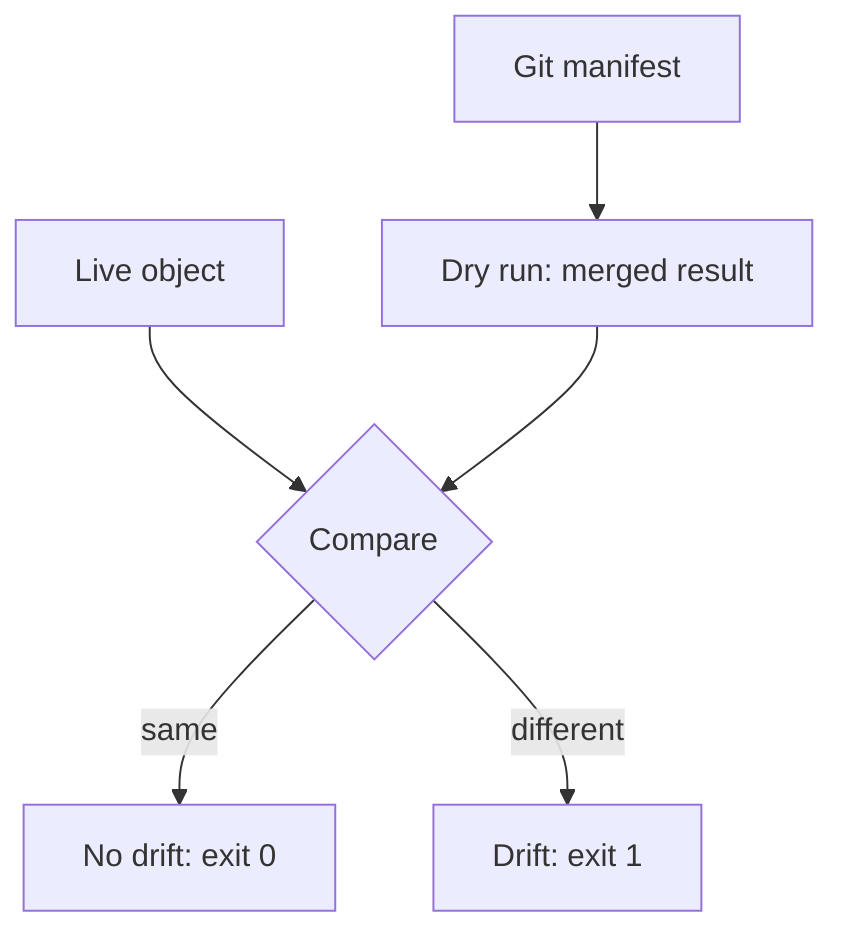

# What Drift Is And How To Detect It

At two in the morning an engineer scales the `scout` Deployment from two to five replicas to survive a traffic spike. The incident ends, and nobody changes the Git repository. A week later the cluster has five replicas, Git says two, and the next person who applies the repository from scratch gets a different system. This part defines that difference and shows how to find it.

Terms first. The **desired state** is what Git declares. The **live state** is what the cluster holds now. **Drift** is any difference between the two that nobody decided by changing Git. A difference that Git already describes but the cluster has not applied yet is not drift. It is a change that is waiting to be delivered.

## Where drift comes from

Drift has a small number of sources, and each one needs a different reaction.

- A person changes a live object with a command such as `kubectl edit`, `kubectl scale` or `kubectl set image`. This is the most common source and it is usually well meant.
- Another controller changes a field. A horizontal pod autoscaler changes `spec.replicas` of a Deployment by design, and the value in Git is only a starting point.
- A mutating admission webhook rewrites objects as they are created, for example to add a sidecar container or a label.
- The API server adds default values for fields that the manifest left out.
- A delivery that stopped halfway leaves some objects at an older state than others.
- An object is created by hand and never described in Git, so no manifest can disagree with it, and it is invisible to a comparison that starts from Git.

Only the first and the last are mistakes in the plain sense. The others are expected differences that the comparison must not report as problems, or must report with a reason.

## Detection is a comparison

Drift is found by comparing two sets of facts. The comparison needs a rule for which fields count. If it counted every field, it would report the uid, the resource version and the default values as drift on every pass. A useful comparison covers the fields that the manifest states, and it applies the same defaulting and merging that an apply would use.

`kubectl diff` does this. It sends the manifest to the API server as a server-side dry run, which means the server computes the object that an apply would store without saving it. It then prints the difference between that result and the live object. The exit status tells a script what happened: 0 means no difference, 1 means differences were found, and a value above 1 means the command itself failed.



The diagram shows that the comparison uses the merged result of a dry run and not the raw file, so default values do not show up as drift.

## Create drift and detect it

In the playground, the repository in `~/gitops-lab/play-040` is applied and matches the cluster. Check that first, and then change the cluster by hand.

<!-- astrona:playground:renew -->

```sh
cd ~/gitops-lab/play-040
kubectl diff -R -f apps
echo $?
```

The diff prints nothing and the exit status is 0. Now scale a Deployment outside of Git and compare again:

```sh
kubectl -n starfleet scale deployment/scout --replicas=4
kubectl diff -R -f apps
echo $?
```

This time the diff shows the `replicas` line with the live value and the declared value, and the exit status is 1. The comparison names the object, the field and both values. That is enough to write a report: the object `scout` in `starfleet` has `spec.replicas` at 4 where Git states 2.

## What a comparison cannot see

A comparison that starts from the manifests has two blind spots. The first is a field that the manifest does not state. If someone adds an environment variable by hand and the manifest has no `env` list, the dry run result has no reason to remove it, so the live value looks like a field that nobody manages. The second is an object that has no manifest. To find those, you list what the cluster has and check each item against the repository, as the earlier work on completeness described.

Because of these blind spots, a clean diff means "everything Git states is true". It does not mean "nothing else exists". A team that wants both runs the diff and the inventory check.

## What a drift report contains

A report that only says "there is drift" cannot be acted on. A useful report names, for each difference, four facts: the object (kind, namespace and name), the field path, the live value and the declared value. It also records when the difference was found and, if it is known, who or what caused it. With these facts a reader can decide without opening the cluster. The `kubectl diff` output already carries the first four, and the cause can often be read from the field ownership records that the API server keeps for each object.

## How long drift lives

Drift exists between the moment a live object is changed and the moment the next comparison runs. If the agent compares every minute, drift is found within a minute. If a team compares only when a person starts a release, drift can live for weeks and be found at the worst time. The comparison interval is the upper bound for how long an unnoticed difference can last, which is why a continuous agent is preferred to a comparison that a person starts.

Finding drift quickly is not the same as closing it quickly. A report is a read operation, and a correction is a write operation. An agent can report a difference without changing anything, or it can change the cluster to remove the difference. Both are valid settings.

The choice depends on how much the team trusts the repository, and on whether manual emergency changes are allowed.

## Drift is a signal, not only a defect

A drift report is information. If the same field is changed by hand every week, the process that forces people to change it by hand is the real problem. Perhaps the review step is too slow for an emergency, or the autoscaler and the manifest disagree about who owns the replica count. Reading drift as a symptom leads to a better fix than reverting it each time.

You can now find drift and say what it is. The next question is what to do with it: put the live value back, or accept it as the new intent.

## Common pitfalls

> [!WARNING]
> Do not treat every difference as drift. An autoscaler, a webhook and API defaults all produce differences on purpose. Do not read a clean `kubectl diff` as proof that nothing else exists in the namespace, because objects without a manifest are not compared. Do not run a script that ignores the exit status: 1 means "differences found", and it is not a failure of the command.
