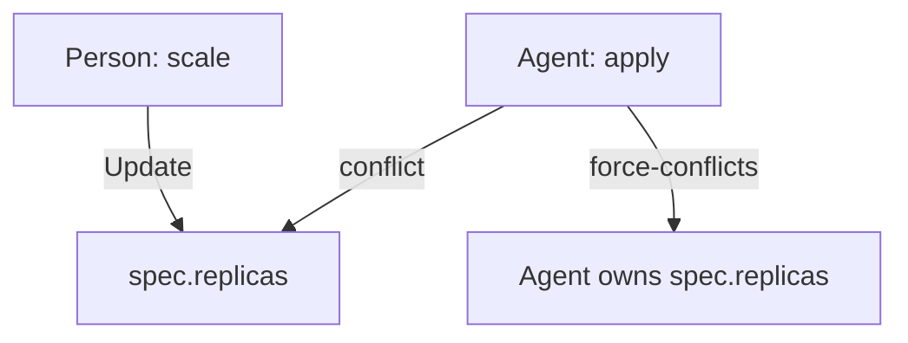

# Reverting, Adopting And Field Ownership

A drift report names a field, the live value and the declared value. Someone has to decide which one is right. This part describes the three possible decisions, and then explains field ownership, the mechanism that decides which tool may change a field and what happens when two tools disagree.

## Three decisions

**Revert** means that Git is right and the cluster is wrong. The agent applies the manifest and the live value returns to the declared value. The drift is closed by changing the cluster. Use this when the change was an accident, an experiment or an unreviewed shortcut.

**Adopt** means that the live value is right and Git is outdated. A person writes the value into the manifest and commits it. After that, the declared value equals the live value and the next comparison shows no difference. The drift is closed by changing Git, and the commit carries the reason. Use this when the change was a deliberate decision that was made in the wrong place, such as the traffic spike that needs five replicas.

**Exclude** means that the field must not be managed by Git at all. If an autoscaler owns the replica count, the manifest should not state `replicas`. Without the field, the comparison has nothing to compare, and the apply has nothing to put back. Use this when another controller is the right owner.

The order matters. Reverting first destroys the evidence that adopting needs: if the change was valuable, the live value is gone as soon as it is applied. Read the report, decide for each field, and only then change either side.

## Revert and adopt in the playground

Create the drift first. Scale `scout` to four and change a memory limit of `probe`:

<!-- astrona:playground:renew -->

```sh
kubectl -n starfleet scale deployment/scout --replicas=4
kubectl -n starfleet set resources deployment/probe --limits=memory=256Mi
kubectl diff -R -f apps
```

Adopt the scale by editing `apps/deployment-scout.yaml` so that it states `replicas: 4`, and commit it. Revert the memory limit by applying the unchanged manifest of `probe`:

```sh
git commit -am "Raise scout to four replicas"
kubectl apply -f apps/deployment-probe.yaml
kubectl diff -R -f apps
echo $?
```

The last diff prints nothing and the exit status is 0. One field was closed by changing Git, and the other one by changing the cluster.

## What apply does not revert

The way `kubectl apply` merges matters here. Client-side apply remembers the last manifest it applied in an annotation, `kubectl.kubernetes.io/last-applied-configuration`. On the next apply it compares three things: the new manifest, the last applied manifest and the live object. A field that the manifest states is set to the declared value. A field that was in the last manifest and is gone from the new one is removed. A field that was never in any manifest is left alone, even if someone added it by hand.

The consequence is that an environment variable added with `kubectl set env` stays after an apply, because no manifest ever mentioned it. The memory limit above was reverted because the manifest states it. A team that needs to close drift in fields that Git does not state must state them, or remove the object and let it be created again.

## Field ownership and server-side apply

Server-side apply moves the merging into the API server and records which manager owns each field. A **manager** is a name that identifies the actor that wrote a field. The record is in `metadata.managedFields`. Read it with:

```sh
kubectl -n starfleet get deployment scout --show-managed-fields -o yaml
```

Each entry has a manager name, an operation (`Apply` or `Update`) and the set of fields that manager owns. A person who ran `kubectl scale` shows up as an `Update` entry that owns `spec.replicas`. A tool that uses server-side apply shows up as an `Apply` entry for the fields in its manifest.

A **conflict** occurs when an applier sets a field that another manager owns, with a different value. The server refuses the request, so one tool cannot silently overwrite another. The applier then has two honest choices: drop the field from its manifest, or take ownership with the `--force-conflicts` flag.

```sh
kubectl apply --server-side --field-manager=gitops-agent -f apps/deployment-scout.yaml
kubectl apply --server-side --field-manager=gitops-agent --force-conflicts -f apps/deployment-scout.yaml
```

The first command is refused when `spec.replicas` is owned by another manager with a different value. The second one takes the ownership and sets the declared value. For a GitOps agent, forcing is the usual choice for the fields that Git declares, because Git is the authority. The agent should still not force fields that it does not declare, since they belong to other tools by design.



The diagram shows that a plain apply is refused on a field another manager owns, and that forcing makes the agent the owner.

## Automatic correction and its cost

An agent can close drift without asking, which is often called self-healing. The benefit is that the cluster returns to the declared state within one interval, and an unreviewed manual change cannot last. The cost is that an emergency change is undone, possibly in the middle of an incident, if nobody committed it. Teams handle this with a rule that is known in advance: emergency changes are allowed and must be committed within a set time, or the agent is paused for the affected application while the incident lasts. The decision between the two settings belongs to the team, and the point is that the setting is explicit.

## Recording the decision

Whichever of the three decisions is chosen, the reason should be written where the next reader will find it. For an adopted change, the commit message states why the live value is right. For a revert, the report or ticket states why the change was not accepted. For an excluded field, the manifest or the repository documentation states which controller owns it. Without that record, the next engineer sees the same difference and has to repeat the analysis.

## Scope: not every drift is yours to close

An agent has a scope: the objects that its repository declares. Another team can run objects in another namespace with their own rules. An agent that applies the whole cluster state to fix drift in its own scope can overwrite those objects. Limit an apply to the files of the scope, and treat objects outside of it as out of reach.

## Common pitfalls

> [!WARNING]
> Do not revert before you decide. The live value is the evidence for the adopt decision. Do not expect `apply` to remove a field that no manifest ever stated, and do not use `--force-conflicts` on fields your repository does not declare, because it takes fields from other tools. Do not apply files outside the scope you own.
