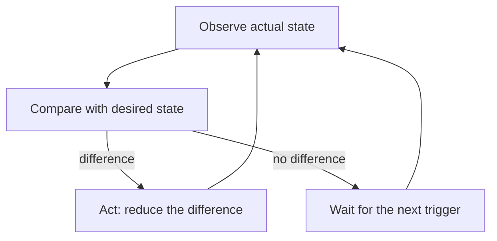

# The Reconciliation Loop

A Deployment declares two replicas. A node fails, and one pod disappears. Nobody runs a command, and a few seconds later there are two pods again. The same mechanism that replaces the pod is the mechanism that a GitOps agent uses to keep the cluster equal to Git. This part describes that mechanism and its properties.

Terms first. A **controller** is a program that watches objects and changes the system to make it match what the objects declare. **Reconciliation** is one controller pass that reads the desired state, observes the actual state, and acts on the difference. A **loop** is that pass repeated. A system has **converged** when the actual state equals the desired state, so another pass has nothing to do.

## The three steps

Every pass has the same three steps.

1. Observe: read the actual state from the system.
2. Compare: find the difference between the actual state and the desired state.
3. Act: make the smallest change that reduces the difference, or do nothing if there is none.



The diagram shows that acting leads back to observing, because the result of an action is checked by the next pass and is never assumed.

## Level-triggered, not edge-triggered

A system is **edge-triggered** when it reacts to events such as "a pod was deleted". It is **level-triggered** when it reacts to the current state, "there is one pod and two are declared". Kubernetes controllers are level-triggered. The difference matters when events are lost. If a controller is down while the pod disappears, an edge-triggered system never learns about it. A level-triggered system notices the missing pod on its first pass after it starts, because it compares the state and does not depend on having seen the event.

Events still exist. Watches tell a controller that an object changed, so it can run a pass soon. The pass itself does not use the event as its input. It reads the state again. If the watch is lost, a periodic full pass covers the gap.

## Idempotent actions

A pass can be repeated, interrupted and restarted. This is safe only because each action is idempotent: doing it again with the same input leaves the same result. Creating "the pod that should exist" a second time does nothing when it exists. An action such as "add one pod" would not be safe to repeat. Controllers therefore express actions as targets ("have two pods") and not as increments.

## See it work

The playground has the `scout` Deployment with two replicas. Delete one pod and watch the controllers react.

<!-- astrona:playground:renew -->

```sh
kubectl -n starfleet get pods -l app=scout
kubectl -n starfleet delete pod -l app=scout --wait=false
kubectl -n starfleet get pods -l app=scout
```

The first command lists the pods. The second asks for all of them to be deleted without waiting. The third lists again and shows pods with new names, because the ReplicaSet controller compared "two declared" with "fewer observed" and created replacements. No one told it to. The Deployment declared a state, and the loop kept it.

Now do the same for the layer above. Change the Deployment by hand and apply the repository:

```sh
cd ~/gitops-lab/play-050
kubectl -n starfleet scale deployment/scout --replicas=4
kubectl apply -R -f apps
kubectl -n starfleet get deployment scout
```

The apply sets the replica count back to the declared value. There are two loops here: the ReplicaSet controller inside the cluster, and the person or agent that applies Git. The second loop can be written as a script that repeats the three steps.

## Applied is not converged

`kubectl apply` reports that an object was configured. That means the API server accepted the new desired state. It does not mean that the system matches it yet. A Deployment is configured in milliseconds, and its pods may need a minute to start. Convergence is a property of the actual state, and it can be checked with a command that waits for it:

```sh
kubectl -n starfleet rollout status deployment/scout --timeout=120s
```

The command waits until the new pods are available, or it fails when the timeout passes. A delivery tool that only confirms "applied" has not confirmed the result.

## What starts a pass

A pass starts for one of three reasons. A watch event says that an object changed. A timer says that the resync interval has passed. A failure of the previous pass schedules a retry. The three together give the loop its behavior: fast reaction in the normal case, a periodic full check that covers lost events, and repeated attempts when something went wrong.

Retries use **backoff**, which means the wait between attempts grows after each failure up to a limit. Without backoff, a failing object would be retried in a tight loop and would load the API server. With backoff, a transient problem is retried soon and a lasting problem is retried at a slow, steady rate.

## Reconciliation at two levels

The cluster contains many loops, and a GitOps setup adds one more. The Deployment controller reconciles a Deployment into a ReplicaSet. The ReplicaSet controller reconciles the ReplicaSet into pods. The kubelet reconciles a pod into running containers. Each loop treats the object above it as its desired state. The GitOps agent sits at the top: it reconciles the repository into Kubernetes objects, and the controllers below take over from there. A failure at a low level, such as a container that crashes, is therefore invisible to the agent unless it reads the status of the objects it created.

## Order and dependencies

Some objects must exist before others. A Namespace must exist before the objects that live in it. A ConfigMap must exist before a pod that reads it can start. An agent that applies everything in one pass may fail a few objects in the first pass for this reason, and the next pass succeeds because the Namespace exists by then. Because the loop repeats, eventual success is accepted for ordering problems, and the agent can reduce the noise by applying namespaces first.

## Common pitfalls

> [!WARNING]
> Do not equate "applied" with "working". Do not write actions that only work once, such as incrementing a counter, because the loop repeats them. Do not stop the loop at the first error: an object that failed in this pass may succeed in the next one, and an unrelated object must still be reconciled.
