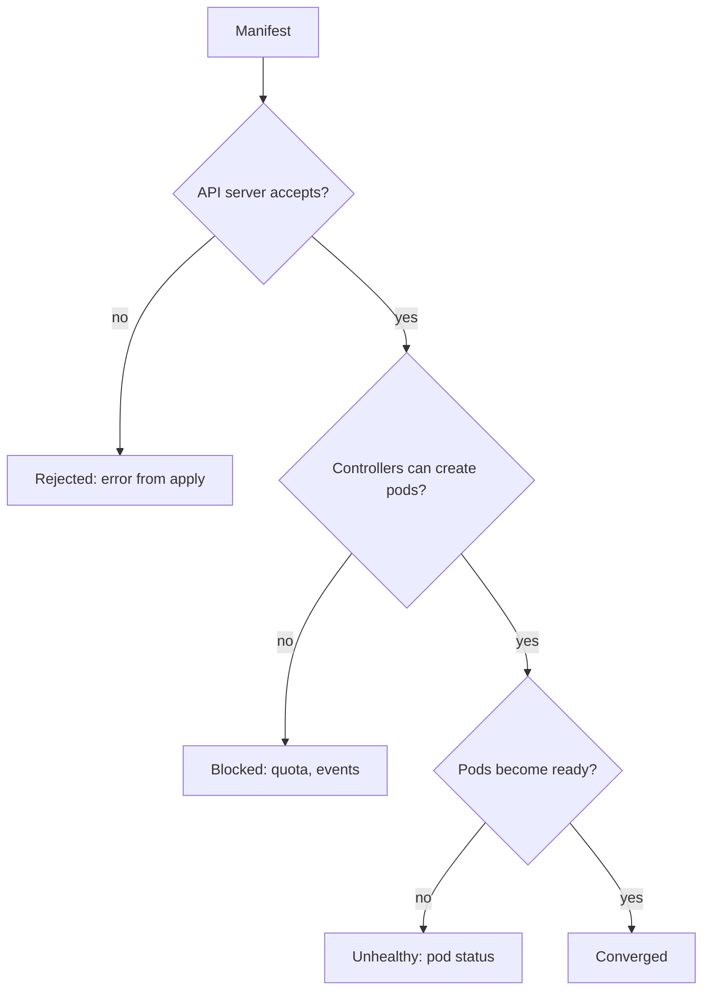

# When Reconciliation Fails

A loop that always succeeds needs no attention. Real deliveries fail for reasons that the loop cannot fix by repeating itself: the image does not exist, the namespace has no room for another pod, or the manifest is not valid. This part separates those failures by where they happen, and shows the signals that identify each one and the way to fix them.

## Three places where a delivery fails

A change moves through three stages, and each stage can refuse it.

- **Rejected**: the API server refuses the object. The cause is validation (a field with the wrong type or an unknown field), a missing namespace, or an admission rule that denies the object. The change never reaches the cluster state, and the apply command reports an error.
- **Blocked**: the API server accepts the object, and a later step cannot create what it needs. A ResourceQuota that limits the number of pods in a namespace is the typical case. The Deployment exists and the ReplicaSet tries to create a pod, but the quota refuses it.
- **Unhealthy**: the pods are created but never become ready. An image that cannot be pulled, a container that crashes and a readiness probe that never succeeds are the usual causes.

The apply command shows a failure only for the first kind. For the other two, the apply succeeds and the evidence is in the objects that the controllers write afterward.



The diagram shows that only the first branch gives an error at apply time, and the other two have to be read from the cluster.

## An image that cannot be pulled

When the image name or tag does not exist, the kubelet cannot pull it. The pod stays in `Pending` with a container waiting reason of `ErrImagePull`, and after repeated attempts the reason is `ImagePullBackOff`. **Backoff** means the kubelet waits longer between each attempt, so the status alternates between the two reasons. A tag that has a typo, such as a letter `O` instead of a zero, produces this status.

The Deployment's rolling update limits the damage. With the default strategy, the Deployment may start one extra pod (`maxSurge`) and may make at most a quarter of the replicas unavailable (`maxUnavailable`, rounded down). For two replicas, that rounds down to zero unavailable, so the old pods keep running while the new pod cannot start. The service stays up, and the rollout never completes. The rollout is stuck, and not broken.

Find the evidence on the cluster:

<!-- astrona:playground:renew -->

```sh
kubectl -n starfleet get pods
kubectl -n starfleet describe pod -l app=scout
kubectl -n starfleet get events --sort-by=.lastTimestamp
kubectl -n starfleet rollout status deployment/scout --timeout=30s
```

The pod list shows the status, the description shows the image and the waiting reason and the events show the failed pull. The rollout command ends with a timeout error when the Deployment cannot progress. When a Deployment has a `progressDeadlineSeconds`, it also records a condition with the reason `ProgressDeadlineExceeded`.

## A quota that blocks pods

A **ResourceQuota** limits what one namespace may use. With a hard limit of `pods: "2"`, the namespace can hold two pods and refuses a third. The Deployment that asks for three replicas has two pods and a ReplicaSet that cannot create the last one. The ReplicaSet records a `FailedCreate` event that mentions the exceeded quota. No pod exists for the failed attempt, so there is no pod status to read: the evidence is in the events and in the quota itself.

```sh
kubectl -n outpost get resourcequota
kubectl -n outpost describe resourcequota
kubectl -n outpost get events
```

The description of the quota lists each resource with its used and hard values, so a namespace at its limit is visible at once. The fix is a decision. Either the quota is too small and Git raises it, or the Deployment asks for too much and Git lowers the replica count.

## A manifest that is not valid

A file with a wrong type, for example a number where a ConfigMap needs a string, is rejected. `kubectl apply -R -f apps` reports an error for that file. For the other files in the directory, the behavior is the reason a loop must not stop at the first error: a valid object should still be reconciled while one file is broken. An agent that gives up on the entire repository because one file fails keeps every other change from being delivered. Check what your tool does, and run `kubectl apply --dry-run=client -R -f apps` in review to find invalid files before they are merged.

## Reading a failure from top to bottom

When a delivery has not converged, read the chain in the order it was created. Start with the Deployment and its conditions, which say whether the rollout is progressing. Continue with the ReplicaSet, whose events tell whether pods could be created. Finish with the pods, whose status and events tell whether the containers could start. Each level has the evidence for the failures that belong to it, and a failure at a low level is reported by the levels above only as "not available".

```sh
kubectl -n starfleet get deployment scout -o yaml
kubectl -n starfleet get replicaset -l app=scout
kubectl -n starfleet get pods -l app=scout
```

The conditions in the first output include `Available` and `Progressing`. A rollout that cannot finish keeps `Progressing` until the deadline passes, and then reports `ProgressDeadlineExceeded` when a deadline is set. The second output shows one ReplicaSet for the old version and one for the new version, with their desired and ready counts. The third output shows the pods that belong to them.

## Retries, and what they cannot fix

Retrying fixes transient causes: the namespace that did not exist yet, a registry that was briefly unreachable, a quota that frees up. It cannot fix a cause that is in the repository. A wrong tag is wrong on every pass. When a failure repeats, the loop should report it, and a person must change Git.

## Fix forward

The fix is a new commit that corrects the cause, and the loop applies it. Editing the cluster by hand to make the symptom go away creates drift, and rewriting the bad commit removes the record of what failed. A new commit records both the failure and the fix. After the commit, wait for convergence with `rollout status` and not only for the apply message.

## Common pitfalls

> [!WARNING]
> An apply that prints no error does not mean the delivery worked, because blocked and unhealthy failures appear later in events and pod status. Do not delete pods to cure a bad image, since the new pod pulls the same image. Do not let one invalid file stop the delivery of all the others.
