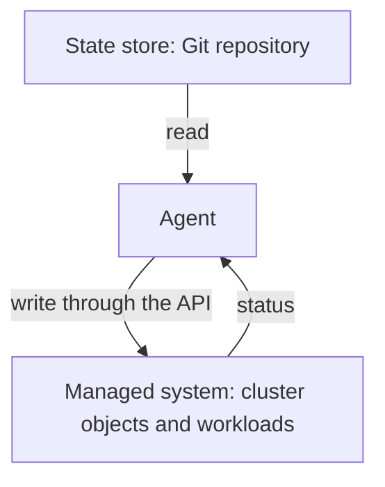

# What The Managed System Is

A team says "we use GitOps for the cluster". The sentence leaves open which part of the cluster, which of its settings, and who is allowed to change what. A GitOps setup is easier to reason about when its three parts are named, and when the edges of the managed part are drawn on purpose. This part names the parts and describes the managed system and its boundary.

Terms first. The **state store** is the versioned place that holds the desired state, a Git repository in this course. The **agent** is the software that reads the desired state and changes the system to match it. The **managed system**, also called the software system or the runtime, is what the agent changes: the objects in a cluster, together with the workloads that those objects run. The **scope** of a managed system is the exact set of objects that one agent is responsible for.

## The three parts and their roles

The three parts are separate on purpose. The state store knows nothing about the cluster, and it only holds text and history. The managed system does not read Git. It only holds objects and runs them. The agent is the only part that knows both sides: it reads the store and writes to the managed system's API.



The diagram shows that the agent is the only part that talks to both sides, and that status flows back to it.

This separation has consequences. The store can be replaced by another one without changing the managed system. The agent can be replaced by another one if the new agent reads the same format and has the same access. The managed system can be rebuilt from the store on a new cluster. Each of these only works while no part depends on the inside of another.

## What belongs to the managed system

The managed system is more than the application. It includes the objects that run the application and the settings around it: Deployments and Services, ConfigMaps, namespaces, quotas, access rules and policies. A cluster also contains objects that exist before any agent runs, and objects that other systems own.

List what a namespace holds, and think about who owns each item:

<!-- astrona:playground:renew -->

```sh
kubectl get namespaces
kubectl -n starfleet get all
kubectl -n starfleet get configmaps,serviceaccounts
```

The namespace list includes the namespaces of the cluster itself, such as `kube-system`, and the ones this course created. The objects in `starfleet` are described in the repository. The ConfigMap `kube-root-ca.crt` and the ServiceAccount `default` appear in every namespace, because the cluster creates them. They belong to the cluster and not to the repository.

## Drawing the boundary

The scope should be written down, because three kinds of objects exist next to each other.

- Objects that the agent owns: they are in the repository, and the agent creates, updates and may delete them.
- Objects that another system owns: another agent, another team's repository or an operator manages them. The agent must not change them.
- Objects that the cluster owns: system namespaces and generated objects. They are part of the platform and are left alone.

Without a written scope, an agent will meet an object that it did not create and will have to guess. A common mistake is a scope that is too wide. An agent with access to the whole cluster can overwrite another team's work, and a mistake in the repository can reach everything. A narrow scope limits the damage that one bad commit can do.

## Scope by namespace, by cluster and by environment

Kubernetes offers natural units for the scope. A **namespace** is the smallest one: one agent per namespace, or one agent that serves a few namespaces. A **cluster** is the next one: one agent per cluster reading its own directory in the repository. An **environment**, such as staging and production, maps to a cluster or a namespace, and should map to a separate directory or branch in the repository so that a change in one does not reach the other by accident.

Cluster-scoped objects, such as namespaces and custom resource definitions, are a special case. A namespaced permission cannot create them. If the agent must manage them, it needs a cluster-level permission, which should be rare and deliberate. Many teams give those objects to a separate bootstrap step that an administrator runs.

## The bootstrap problem

The agent needs permissions before it can apply anything, and the permissions are objects in the cluster. Someone with higher rights must create the agent's identity first. This is **bootstrapping**. The bootstrap objects are described in the repository too, and are applied once by an administrator, in a directory that the agent itself does not apply. The agent should not be able to change its own permissions, or one bad commit would be able to grant everything.

## Declared state and live state

The managed system has two views. The **declared state** is what the repository says should exist. The **live state** is what the cluster holds right now. The agent compares them and acts on the difference. Objects that exist only in the live state are either outside the scope or are drift. The scope decides which of the two they are, so a written scope turns an unclear leftover into a clear decision.

Compare the two for one namespace:

```sh
kubectl diff -R -f apps
```

`kubectl diff` prints the differences between the files and the cluster and exits with 0 when there are none. It only looks at objects that the files name. It never lists objects that are missing from the files, which is why pruning, the removal of objects that left the repository, needs a record of what the agent applied earlier.

## Ownership of a single object

Kubernetes records who last wrote each field of an object. The record is called `managedFields` and is stored in the object's metadata. Two writers that change the same field conflict, and the second one is told. For the scope this means that two agents must not manage the same object. Give each object one owner, and make the owner visible in the repository layout, for example one directory per owner.

```sh
kubectl -n starfleet get deployment scout -o json | jq '.metadata.managedFields[].manager'
```

The command prints the names of the managers that wrote fields. `kubectl` is the manager for objects that you applied by hand. An agent shows up under its own name.

## One scope or many

A single agent for a whole company is easy to start and hard to restrict. Many small agents are more work to set up and limit the damage of each mistake. A middle path gives one agent to each team or environment, and keeps shared platform objects in a scope of their own with its own review rules. Whatever the choice, each agent needs its own identity, so that the logs and the permissions say which agent did what.

The managed system also changes over time. A new team joins, a namespace moves, a cluster is added. Treat a change of scope like any other change: make it in the repository, review it, and let the bootstrap step create the new identity and permissions.

## Common pitfalls

> [!WARNING]
> Do not give one agent the whole cluster because it is easier. Do not let the agent manage its own permissions. Do not treat objects that the cluster generates, or objects another team owns, as part of your scope. Write the scope down, and keep the bootstrap objects apart from the objects that the agent applies.
