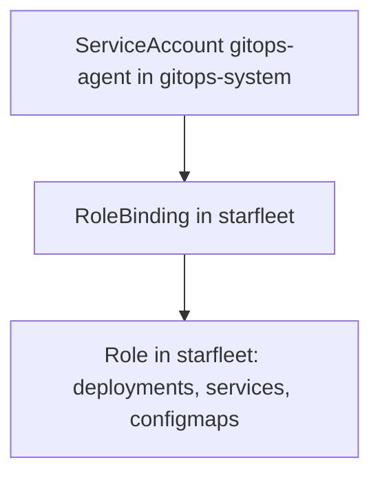

# Agent Identity And Least Privilege

An agent changes the cluster, so it must be allowed to. The question is how much it is allowed to do. This part describes how an agent gets an identity in Kubernetes, how permissions are attached to it, and how to apply the principle of least privilege and test the result.

## Identity: the ServiceAccount

Every request to the API server comes from an identity. A person has a user identity from the cluster's login method. A program that runs in the cluster has a **ServiceAccount**, which is a namespaced object that gives pods an identity. Its full name as the API server sees it is `system:serviceaccount:<namespace>:<name>`. An agent that runs in the cluster uses a ServiceAccount, and its pod receives a token for it.

Create a namespace and an identity for the agent. Save this as `platform-agent.yaml`:

```yaml
apiVersion: v1
kind: Namespace
metadata:
  name: gitops-system
---
apiVersion: v1
kind: ServiceAccount
metadata:
  name: gitops-agent
  namespace: gitops-system
```

<!-- astrona:playground:renew -->

Apply it:

```sh
kubectl apply -f platform-agent.yaml
```

A ServiceAccount has no permissions when it is created. A request from it is authenticated, which means the cluster knows who it is, and then denied, because nothing allows it.

## Permissions: Role and RoleBinding

Kubernetes uses role-based access control, shortened to **RBAC**. A **Role** is a list of rules in one namespace. Each rule names API groups, resource types and verbs, which are the actions such as `get`, `list`, `create`, `patch` and `delete`. A **RoleBinding** attaches a Role to one or more subjects, such as the ServiceAccount. A ClusterRole and a ClusterRoleBinding do the same for the whole cluster.

A rule for the agent of the `starfleet` namespace could read:

```yaml
apiVersion: rbac.authorization.k8s.io/v1
kind: Role
metadata:
  name: gitops-agent
  namespace: starfleet
rules:
  - apiGroups: ["apps"]
    resources: ["deployments"]
    verbs: ["get", "list", "watch", "create", "update", "patch"]
  - apiGroups: [""]
    resources: ["services", "configmaps"]
    verbs: ["get", "list", "watch", "create", "update", "patch"]
```

The group `apps` holds Deployments, and the empty group name holds the core types such as Services and ConfigMaps. The binding then names who gets the rules:

```yaml
apiVersion: rbac.authorization.k8s.io/v1
kind: RoleBinding
metadata:
  name: gitops-agent
  namespace: starfleet
roleRef:
  apiGroup: rbac.authorization.k8s.io
  kind: Role
  name: gitops-agent
subjects:
  - kind: ServiceAccount
    name: gitops-agent
    namespace: gitops-system
```

The Role lives in `starfleet`, and the subject lives in `gitops-system`. A binding can name a subject from another namespace, and the permissions apply only in the namespace of the Role.



The diagram shows that the permissions come from the binding and the role together, and they stop at the namespace of the Role.

## Least privilege

**Least privilege** means giving an identity only the permissions that its job needs and nothing more. For an agent, the job is to create and update the kinds of objects that the repository declares. It does not need to read Secrets, to delete namespaces, or to change roles. The risks are concrete. If the agent has `cluster-admin`, a mistaken or malicious commit can change anything, and a stolen agent token gives the attacker the same power.

Two rules make the review simple. Avoid the wildcard `"*"` in verbs, resources and API groups. Do not give the agent the ability to create or change Roles and RoleBindings in its own scope, because that allows it to grant itself more. Whoever needs more access should ask through a change in the bootstrap objects, which a person with higher rights applies.

## Test the permissions

A permission is testable. `kubectl auth can-i` asks the API server whether an identity may do something, and an administrator can ask it for another identity with `--as`:

```sh
kubectl auth can-i patch deployments -n starfleet --as=system:serviceaccount:gitops-system:gitops-agent
kubectl auth can-i get secrets -n starfleet --as=system:serviceaccount:gitops-system:gitops-agent
kubectl auth can-i delete namespaces --as=system:serviceaccount:gitops-system:gitops-agent
```

Each command prints `yes` or `no`, and the exit status is 0 for yes and 1 for no. After the Role and the binding exist, the first is expected to be `yes` and the other two `no`. Write such checks for every permission that the agent should have and every one that it must not have. The negative checks protect against a Role that grew too wide.

## Where the credentials live

A pull-based agent runs inside the cluster, and its token never leaves the cluster. The credential that it needs outside, to read the repository, should be read-only. A push-based pipeline runs outside, so it needs a credential for the cluster API that works from the outside, and that credential must be stored in the pipeline system. Both cases need the same least privilege review. The pull model has the smaller exposure, because no cluster credential is stored elsewhere.

## Common pitfalls

> [!WARNING]
> Do not bind the agent to `cluster-admin` to make errors go away. Do not use `"*"` in a Role, and do not let the agent edit Roles or RoleBindings in its own scope. Test the denials as well as the permissions, because a check that only tests `yes` passes for an identity with too much power.
