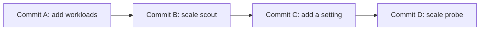

# The State Store And Its History

The desired state has to live somewhere. A GitOps setup puts it in a **state store**, a system that holds the declared configuration and every earlier version of it. This part explains what the store has to provide, why Git provides it, and what a commit holds that a plain file does not.

## What a state store must provide

Three properties make a store fit for GitOps.

- **Versioned.** Every change is a new version, and older versions stay available. The question "what did we declare last Tuesday" has an answer.
- **Immutable.** A version that was recorded cannot be changed afterwards. A new change is a new version. Without this, history could be edited to hide a mistake, and a version number would not identify one fixed content.
- **Auditable.** Each version says who made it, when, and with what message, and it can be tied to a review.

A shared folder or a database row can hold configuration, but it does not give all three by default. Git does, because of how it stores data.

## How Git stores a version

A **commit** in Git is a record. It points to a complete snapshot of the files, to its parent commit or commits, and carries an author, a date and a message. Each record has an identifier that is a hash of its content, called the **SHA**, forty hexadecimal characters long. Because the parent's SHA is part of the content, changing any old commit changes the SHA of every commit after it. This chain of hashes is what makes the history tamper-evident: a rewritten history has different identifiers, and anyone who holds the old ones can see it.



The diagram shows a linear history in which each commit records its parent, so the whole chain is fixed by the last identifier.

## Reading the history

Open the repository of the playground and read it:

<!-- astrona:playground:renew -->

```sh
cd ~/gitops-lab/play-070
git log --format='%h %an %ad %s' --date=short
git show --stat HEAD
git show HEAD~1:apps/deployment-scout.yaml
```

The first command lists one line per commit with the short SHA, the author, the date and the subject. The second shows which files the newest commit changed. The third prints a file as it was in an earlier commit: the syntax `<revision>:<path>` reads one file from one revision without changing your working directory.

`git diff <old> <new> -- apps` shows what changed between two revisions. This is the tool for a review, and it is what the agent sees when the repository moves from one revision to another.

## The history as an audit trail

Every desired-state change is a commit, so the commit list answers audit questions: who raised the replica count, when, and with which message. For the answers to be trustworthy, two conditions must hold. The authors must be identified, which on a shared platform means signed-in accounts and, where required, signed commits. The history must stay intact, which means that the main branch refuses forced updates and deletions. A team that rewrites the history of its main branch loses the audit trail even if every commit was once honest.

Commit messages carry the reason. A message such as "Scale scout to 3" states what changed, and the reason belongs in the body. A **trailer** is a line at the end of a message in the form `Key: value`, such as `Reviewed-by: Ada Voss`. Tools read trailers, so they are a way to attach structured facts, like who reviewed a change, to a commit.

## Branch protection and signed commits

The store only stays trustworthy if the platform that hosts it enforces rules. **Branch protection** is a set of rules on a branch: no forced updates, no deletion, and often a required review before a change can merge. With these rules, the commits on the branch the agent follows have passed the same gate. **Signed commits** add proof of the author: a cryptographic signature that the platform can check against the author's registered key. A signature shows that the holder of the key made the commit, which a plain author name does not, because anyone can set an author name in their own Git configuration.

Check what Git recorded as the author and the committer of the newest commit:

```sh
git log -1 --format='author: %an <%ae>%ncommitter: %cn <%ce>'
```

The two can differ, for example after a rebase or when a platform merges a change. Both are text that the person creating the commit chose, which is why signatures and platform rules carry the trust and the names alone do not.

## Size and shape of a change

A small commit is easier to review and easier to undo. A commit that changes one application in one environment can be read in a minute and removed by itself. A commit that changes ten applications at once cannot be removed without also removing the nine good changes. When you search a history later, small commits also make the answer sharper: the commit that introduced a problem is short, and its message names the intent.

## The store is not the cluster

The repository holds the intent. It does not know whether the cluster matches it. A revision exists in the store whether or not any agent has applied it. This is why a team needs a way to say which revision is in use. The agent reads one branch, or one tag, and that choice is the connection between the store and the cluster.

Three ways exist to point the agent at a revision.

- A **branch** moves forward with each new commit. An agent that follows `main` always applies the newest commit.
- A **tag** is a fixed name for one commit. An agent that follows a tag applies that commit until someone points it at another tag.
- A **commit SHA** is exact, and it is hard for people to read.

The choice has consequences. Following a branch is the fastest way to deliver and the fastest way to deliver a mistake. Following a tag adds a deliberate step before anything changes, which slows delivery and makes each change a decision.

## Layout of the repository

The structure of the files matters because the agent reads it. A directory per environment, such as `apps/staging` and `apps/production`, lets the same history serve both and lets a review target one. A directory per application keeps changes small. Plain manifests can sit side by side, and a tool such as a templating system can generate them from shared parts. Whatever the layout, the repository should contain only declared state: no generated output, no secrets in plain text and no copy of live cluster data.

Secrets are a special case. A secret value must not appear in a repository's history, because history is permanent and copied. The repository can hold a reference to a secret, or an encrypted form that only the cluster can read. This course does not set up secret handling. The point here is that immutability works against you if a secret is committed once.

## Common pitfalls

> [!WARNING]
> Do not rewrite the history of the branch that the agent follows, and do not allow forced updates on it. Do not put secrets or generated files in the repository. Do not rely on a branch name as a record of what runs in the cluster, because the branch moves. Use a tag or a recorded SHA when you need to name one exact revision.
