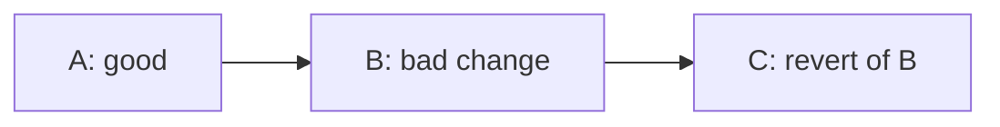

# Why Rollback Is A Commit

Every delivery system needs a way back. In a GitOps setup, the way back follows from the main idea: the repository is the source of truth, and the cluster follows it. If the cluster is wrong because the repository is wrong, the repository must change. This part explains what a rollback is in that setting, why the quick commands on the cluster are the wrong tool, and which two kinds of undo exist in Git.

## What a rollback is

A **rollback** returns a system to an earlier working state. In GitOps the state is the content of the repository, so a rollback is a change of the repository whose result equals the earlier content. The agent notices the new revision and applies it, as it does with every other change. Nothing special happens in the cluster: the rollback is an ordinary delivery whose content happens to match an old one.

This has benefits. The rollback is reviewed, recorded and attributed like any change. It can be rolled back itself. And it works the same for every environment and every agent.

## Why not undo on the cluster

Kubernetes has its own command, `kubectl rollout undo deployment/<name>`, which returns a Deployment to the previous ReplicaSet. It is fast, and it is available to anyone with the right permissions. In a GitOps setup it creates a conflict. The repository still holds the bad change, so the next reconciliation of the agent compares the cluster to the repository, sees the difference and applies the bad change again. The fix lasts until the next sync.

A manual undo can be useful as a first aid when an incident is running, if the agent's synchronization is paused at the same time. It must then be followed by a commit that makes the repository say the same thing. Otherwise the repository and the cluster disagree, which is the drift that GitOps exists to remove.

## Two ways to undo in Git

Git offers two kinds of undo, and they have opposite effects on history.

- **`git revert <commit>`** creates a new commit that applies the opposite of the given commit. The old commit stays in the history. Anyone who already has the history can fetch the new commit like any other. The history only grows.
- **`git reset --hard <commit>`** moves the branch pointer back and discards the later commits from the branch. The history is rewritten. Everyone who has the later commits now has a history that conflicts with the shared one, and a shared branch normally refuses the change unless it is forced.

For a branch that an agent follows and that people share, the answer is `git revert`. It leaves the audit trail whole: the bad commit, the reason for it, and the commit that reversed it are all visible.



The diagram shows that a revert adds commit C after the bad commit B, and the content of C equals the content of A.

## What git revert does

`git revert B` computes the difference that B introduced, applies the reverse of it to the current state and records the result as a new commit. The message defaults to `Revert "<subject of B>"` followed by the line `This reverts commit <sha>.` The command works on the current content, not on the old one. If later commits touched the same lines as B, the reverse change may conflict, and Git stops and asks for a resolution.

Try it in the playground, where the newest commit points the `probe` Deployment at an image tag that does not exist:

<!-- astrona:playground:renew -->

```sh
cd ~/gitops-lab/play-090
git log --oneline
git revert --no-edit HEAD
git log --oneline
git diff HEAD~2 HEAD -- apps
```

The history now has one more commit. The last command compares the state before the bad commit and the state after the revert, and it prints nothing, because the two are the same. This equality is the check that a rollback worked at the file level.

## Roll back or roll forward

A rollback is not always the best answer. **Rolling forward** means fixing the problem with a new change instead of reversing the old one. Rollback is the better choice when the cause is unclear and the previous state is known to be good, because it restores service quickly. Rolling forward is better when the previous state is not available, for example after a change that cannot be reversed, or when the fix is small and understood. In both cases, the result is a new commit on the same branch.

## Pausing the agent during an incident

During an incident the cluster may need a manual action before the repository can be fixed. Most agents can pause synchronization for one application or for all of them. Pausing stops the agent from overwriting manual changes. It also means that the cluster no longer follows the repository, so the pause should be short, announced and recorded. When the fix is in the repository, resume the agent and confirm that the cluster matches it. A pause that nobody remembers is a drift that nobody sees.

## Who may roll back

Rollback is a change like any other, so it follows the same access rules. On a protected branch, a revert goes through the same review as other changes, and this can feel slow in an emergency. Many teams define a faster path for reverts: a smaller review, or a rule that a revert of a recent commit by its own author may merge at once. The rule should be written down in advance. A team that invents the process during an outage tends to skip the record.

## How far back

The farther back a rollback goes, the more it touches. Reverting the newest commit is usually safe. Reverting a commit from last month may conflict with everything that came after, and the old state may not fit the current cluster: a schema may have changed, a dependency may have moved on, and the old image may have been deleted from the registry. Before a long rollback, check that what the old state needs still exists. The recent tag or release marker of a known good revision makes this choice easier.

## Rollback in the audit trail

A rollback leaves three facts in the history: the original change, the reason it was reversed, and the commit that reversed it. A reader can follow the whole story with `git log`. To see everything that touched a file, including its reverts, use:

```sh
git log --format='%h %an %s' -- apps/deployment-probe.yaml
```

The list shows the original commit and the revert next to each other. Compare this with a reset, where the bad commit would not be on the branch at all and the record of the incident would exist only in chat messages and memory.

Revert commit messages should say why. The default text only says what was reversed, so add a body with the reason and the incident reference when you have one.

## What the cluster keeps

Reverting a commit changes the declared state. It does not change data that never lived in Git. A ConfigMap that an application writes at runtime, the contents of a database and the files on a volume are not in the repository, so a revert does not touch them. If the bad change also damaged that data, the revert will not repair it. Restoring data needs a backup, which is a different mechanism.

The opposite risk exists too. An agent that deletes objects that are no longer in the repository, called pruning, can remove live data when a revert removes the manifest that created it. Whether pruning is on is a setting of the agent, and it should be known before anything is reverted.

## Common pitfalls

> [!WARNING]
> Do not use `git reset --hard` on a branch that other people or an agent read. Do not use `kubectl rollout undo` as the only fix, because the next sync brings the bad change back. Do not assume a revert restores data that the bad change damaged. Check whether the agent prunes before you revert a commit that added or removed objects.
